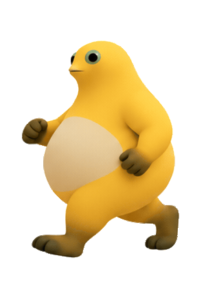

# 奶蛙桌宠 1.1.2（音效版）

适用于 Windows 10 / 11 的透明桌面宠物，基于原有奶蛙立绘与捧腹动画。支持外接显示器、滚轮缩放和不同部位的点击互动。

## 启动与操作

下载整个项目并解压，双击 `启动奶娃桌宠.bat` 或 `NaiwaPet.exe`。请将 `laugh.mp3`、`NaiwaPet.exe.config` 保留在 EXE 同目录。程序有任务栏入口和通知区域图标。

| 操作 | 反应 |
| --- | --- |
| 按住左键拖动 | 跟随光标移动并迈腿跑动；向右时镜像跑姿，松开后站稳 |
| 点击头部 | 轻晃头部，带逐渐减弱的回弹 |
| 点击肚子 | 播放原有捧腹大笑动画和笑声音效 |
| 点击手部 | 轻轻摇摆 |
| 点击腿或脚 | 两腿分开屈膝、双手抬起，完整姿态保持 **2 秒**，然后收势 |
| 鼠标滚轮 | 调整大小，角色脚底位置保持稳定 |
| 右键 | 选择动作、恢复默认大小、移至鼠标所在屏幕、开关笑声、隐藏或退出 |
| Esc / 关闭窗口 | 隐藏到通知区域；双击通知图标再次显示 |

拖动和新的点击互动可以打断动作，并停止旧的笑声。缺少或无法播放音频时，画面仍可正常运行。

## 1.1.2 跑姿更新

- 重做 12 个步态姿势，包含落脚、屈膝承重、收腿经过身下、蹬地和腾空，缩小步幅。
- 补足近侧手臂摆到肚子前方的姿势，两只手臂随对侧腿交替前摆，避免同一只手一直在前。
- 一个完整左右脚周期为 0.8 秒，落脚与收腿阶段适当停留，腾空较短。
- 身体中心水平对齐，保留脚自然抬离地面的高度，并加入连续起伏与轻微承重压缩。
- 向右拖动时围绕身体中心镜像，减少转向时位置跳动。



## 1.1 更新

- 拖动改用屏幕坐标与原生窗口移动，修复窗口内坐标变化造成的回拉和卡顿。
- 使用固定透明画框，捧腹大笑不再额外放大窗口；按首帧可见角色高度、脚底位置统一比例。同一段动画使用同一倍率，保留弯腰和起伏。
- 预载并缓存图片，用实际经过时间驱动动作。头部和手部按显示刷新时机更新，捧腹素材保持原来的 12 FPS、92 帧长度。
- 增加参照原立绘生成的跑姿和战斗姿态。待机立绘和原捧腹视频帧继续使用原来的图片。
- 所有动作预留画框边距，透明边缘不作为可点击角色区域。
- 增加每显示器 DPI 声明，以及“移到鼠标所在屏幕”入口。

## 从源码编译

需要 64 位 Windows 和 **.NET Framework 4.8 或更新的 4.x 版本**（当前 Windows 10 / 11 通常已包含）。无需安装 Python、Node.js、Unity 或额外模型。

```powershell
powershell -ExecutionPolicy Bypass -File .\build.ps1
```

编译并检查动作计时、图像边界、透明区域，输出动作预览：

```powershell
powershell -ExecutionPolicy Bypass -File .\build.ps1 -Check
```

## 文件与素材

- `src/NaiwaPetSprite.cs`：窗口、拖动、动作与绘制源码。
- `src/laugh_frames/`：原有捧腹大笑的 92 张透明视频帧。
- `assets/run-cycle-v2.png`：4×3 动作图，12 个完整跑步相位。
- `assets/run-preview.gif`：程序实际绘制的跑姿循环预览。
- `assets/battle-sheet.png`：3×2 动作图，包含准备、战斗和收势姿态。
- `assets/PROMPTS.md`：新增动作素材的生成方式与最终提示词。
- `src/app.manifest`、`src/app.config`：Windows 与 DPI 设置。
- `tests/NaiwaPetChecks.cs`：坐标、缩放、计时、透明处理及画框检查。

新增动作图使用纯白底。程序加载时仅移除与图像外缘相通的浅白背景，保留内部的浅色肚皮和眼睛。素材内置于程序，运行时无需另外加载这两张图。
